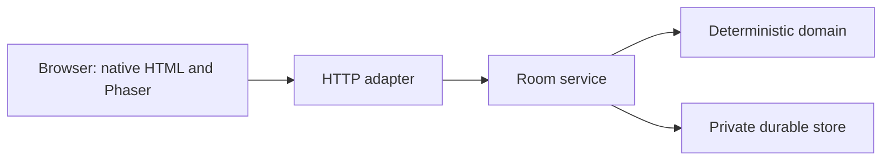

# Architecture Spine — family-monopoly

## Design Paradigm

Layered server-authoritative command processing. Browser views submit intents through HTTP; room services authenticate and commit; deterministic domain reducers determine outcomes. Domain logic does not depend on transport, persistence or presentation.

## Invariants & Rules

### AD-1 — Authoritative deterministic outcomes [ADOPTED]
- **Binds:** All match modes and domain rules.
- **Prevents:** Clients or animation producing conflicting outcomes.
- **Rule:** Only the server supplies random inputs and runs the reducer. Persist accepted random outcomes and pinned board/rules content with the match; effects derive from committed state and inputs. Dispatch persisted matches to their server-owned profile and version on restart; reject unsupported versions without changing the match.

### AD-2 — Atomic room command boundary [ADOPTED]
- **Binds:** Room services and persistence.
- **Prevents:** Lost updates, duplicate settlement and receipts diverging from state.
- **Rule:** Serialize room writes, including writes to any shared store record; atomically commit state, revision, command receipt and revisioned events. Authenticate the session-derived actor; scope receipts by room and stable seat, return the original receipt for an identical retry before checking expected revision, reject changed payload reuse, and publish only committed results.

### AD-3 — Authorized views and resynchronization [ADOPTED]
- **Binds:** HTTP adapters and clients.
- **Prevents:** Seat impersonation, hidden-data disclosure and stale projections.
- **Rule:** Invites admit only to a lobby; seat sessions authorize reads and commands. Apply authorization and redaction to snapshots and event history. Never expose other seats' credentials, undealt deck order, random state or internal queues. Discard duplicate events and fetch an authorized snapshot on gaps or reconnect; submit a new intent only after resync.

### AD-4 — Shared-device and private-device boundaries [ADOPTED]
- **Binds:** Local and private play.
- **Prevents:** The local seat bundle becoming a remote impersonation mechanism.
- **Rule:** Local mode keeps separate seat sessions in a trusted shared browser, explicit handoffs and a shared connection lease. A private device receives only its own seat session and cannot select another seat's credentials. Server authorization remains final.

### AD-5 — Accessible projection [ADOPTED]
- **Binds:** Local board and all action clients.
- **Prevents:** Renderer choice or motion hiding essential information or determining rules.
- **Rule:** The local table uses Phaser to render accepted snapshots/events with Canvas fallback; native HTML supplies equivalent spaces, actions and announcements. All clients preserve readable controls, keyboard, touch and reduced motion; optional animation never changes outcomes. Localize copy separately from pinned rules and board content.

### AD-6 — Pilot recovery and seat ownership [ADOPTED]
- **Binds:** Future remote pilot, room persistence and seat recovery.
- **Prevents:** Restart losing a match or device change granting control of another seat.
- **Rule:** Preserve committed match state, pending decisions, pins, revisions, receipts and seat authentication across restart. A private, high-entropy per-player recovery code reclaims only its stable seat. Atomically issue a new session and invalidate the old one against concurrent commands; preserve that seat's receipts. Protect verification data, use encrypted transport and rate-limit attempts. An invite or host cannot reset an existing seat. If both session and recovery code are lost, start a new match. Do not expose secrets in logs or projections.

## Stack

Existing repository pins, not an upgrade recommendation: Bun 1.4.4; Phaser 3.90.0; JavaScript ES modules. Official references: [Bun](https://bun.com/docs), [Phaser](https://docs.phaser.io/).

## Structural Seed

`src/domain/` owns game decisions; `src/rooms/` owns room authority and persistence; `src/web/` owns HTTP and browser projections. Current private UI uses the synthetic profile; authored full-match private rooms require explicit server-side profile dispatch.

The initial remote pilot targets at most four people and accepts brief maintenance interruptions. A single instance is the working deployment direction, not an approved hosting design. The current localhost server and temporary default file are prototype-only; remote operation requires configured durable storage and verified restart recovery. One process per current store file remains mandatory until replaced by a storage design that preserves AD-2.

## Capability → Architecture Map

| Capability | Boundary | Rules |
| --- | --- | --- |
| US-01–02 private admission | HTTP and rooms | AD-2–4 |
| US-03–04 turns and auctions | rooms and domain | AD-1–3 |
| US-05 reconnect and device recovery | rooms, store and client | AD-2–4, AD-6 |
| US-06 accessible play | browser projections | AD-1, AD-5 |
| US-07 full-match decisions | rooms and domain | AD-1–3 |
| US-08 shared browser | local client and rooms | AD-1–5 |

## Deferred

- Provider, data store, backup/restore, secret management, TLS, rate limiting, observability and deployment topology: choose and test in the authorized hosting slice before remote access. A single instance is the current pilot direction; scaling requires a revised serialization design.
- Recovery-code issuance, protected delivery, rotation and recovery-response loss semantics: decide and test before device recovery ships, preserving AD-6. Update upstream requirements and scenarios before implementation; existing ADR-003 and EPIC-003 defer this capability.
- Renderer for private-device full-match play: select in its authorized slice; ADR-007 binds the local table only.
- Retention, abandonment, cleanup and backup deletion: owner policy and scenarios before implementation. Real-device, family, language, branding, accessibility and distribution reviews remain B-09 gates.
- Authored-profile private-room dispatch, production security and deployment remain future authorized slices; this spine does not authorize implementation, invitations or hosting.
